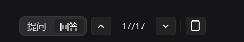
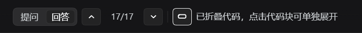

# Q&A Jump · dsh-qa-jump

A one-row navigation bar for the **DeepSeek Harness (DSH) Web GUI**, built for long replies:

```
[Question][Answer]  [↑] 3/12 [↓]  [▭/▬]
```

- **Two axes**: switch between *Question* and *Answer*, then jump to the **start** of the previous/next one.
- **Answers start at the reply**: the landing point is the turn's first output row, so the “已完成，用时 N 秒” summary line stays visible — not the turn tail where the “edited N files” summary lives.
- **Boundaries still act**: with a single answer, the button parks that answer at the top; the “already at the last answer” hint only appears once it really is there.
- **Code folding**: fold/unfold code blocks in replies (click one block to reopen it while folded). The icon shows the state: a full-height frame when open, a squashed frame when folded.
- **One row, mobile friendly**: `nowrap` layout plus narrow-screen and coarse-pointer breakpoints, fits 320px; `touch-action: manipulation` on buttons.

## Screenshots

The control row (Question / Answer axes; `17/17` means the last item is at the top):



With code folded (the icon becomes a squashed frame and the hint appears):



## Install

```bash
# recommended: install from npm (no build step, no build approval)
dsh plugin --profile web add dsh-qa-jump

# or from the GitHub source
dsh plugin --profile web add github:sol-ray/dsh-qa-jump
```

Restart DSH (or reload the Web GUI); the row appears above the composer.

Local checkout:

```bash
dsh plugin --profile desktop add /path/to/dsh-qa-jump
```

Uninstall:

```bash
dsh plugin --profile web remove dsh-qa-jump
```

## Usage

| Action | Result |
|---|---|
| Click `Question` / `Answer` | Switch the navigation axis; the counter follows |
| `↑` / `↓` | Jump to the start of the previous/next item on that axis (12px gap) |
| `3/12` | Position of the item at the top of the viewport / total |
| `▭` full frame | Fold every code block; click again (`▬` squashed frame) to unfold |
| Click a block while folded | Open just that block; click again to fold it back |
| Drag-select text, or click the block’s copy button | Does not toggle folding |

## How it works

- Injected through **Cordis Slots**: `conversation.input.dock` (the control row) and `conversation.chat.assistant-actions` (an invisible per-answer anchor, fallback only).
- Positioning uses the shell’s stable DOM hooks: `[data-conversation-scroll]` (scrollport) and `[data-chat-flow-kind]` (row kind: `user` / `steering` / `assistant-step` / `turn-tail` …).
- The answer axis is “the first `assistant-step` row after each user row”, so it lands on the reply’s start instead of the turn tail; the question axis uses `user` / `steering` rows.
- **Jumps also work while the model is still writing**: in that state the shell follows the tail itself and re-parks the scrollport at the floor on every content growth, which cancels an animated scroll on its first frame. The plugin therefore parks the row synchronously and dispatches `scroll` / `scrollend` to hand the scrollport back to the reader (the shell uses exactly those two events to decide that a reader position settled), so later chunks no longer drag the view back down.
- Code folding is **pure CSS**: one plugin-owned attribute on `<html>` clamps `[data-conversation-scroll] pre` to 156px, and `data-daj-code-open` lifts the clamp for one block. The message renderer is never rewritten.

## Compatibility and limitations

- Developed against **DSH 0.2.1-rc.5** (Windows Desktop / Web GUI).
- Depends on the DOM hooks above. If upstream renames the kinds, the answer axis falls back to the anchor mapping (coarser, still functional).
- Folding targets the `<pre>` inside fenced blocks (`md-code-block`), keeping the language label and copy button.
- While the shell follows the tail (during generation, or right after it while you sit at the bottom) a jump **teleports** instead of gliding: the shell’s re-park cancels the animation. Once you have scrolled up (the tail is released) jumps are smooth again.
- Screenshots come from a real local run (DSH 0.2.1-rc.5, Windows desktop, dark theme) and cover the control row only; the effect of folding on long code blocks is not shown.

## Release

Releases go out through GitHub Actions with an **npm Trusted Publisher (OIDC)** — no OTP and no long-lived token.

**Trigger**: push a `v*` tag on `main`, or run the workflow manually from the Actions tab.

```bash
git tag v1.6.5
git push origin v1.6.5
```

The workflow lives in `.github/workflows/publish.yml`: `permissions` are `contents: read` + `id-token: write`, Node 22, and it runs `npm publish --provenance --access public`. **`NODE_AUTH_TOKEN` is deliberately not set** — authentication comes entirely from the OIDC identity.

**One-time setup** on npmjs.com:

1. **Make the package exist on the registry first.** npm does **not** support configuring a Trusted Publisher for a package that has never been published (see below), so version one has to go out manually or with a token:
   - With 2FA enabled: `npm publish --otp=<6-digit code>`;
   - or create a temporary granular token with **bypass 2FA**, publish once, then revoke it.
2. Open `https://www.npmjs.com/package/dsh-qa-jump` → **Settings** → **Trusted publishing** → **Add trusted publisher** → **GitHub Actions**, then fill in:

   | Field | Value |
   |---|---|
   | Organization or user | `sol-ray` |
   | Repository | `dsh-qa-jump` |
   | Workflow filename | `publish.yml` (filename only, no path, must include `.yml`) |
   | Environment name | leave empty |
   | Allowed actions | **check `npm publish`** |

3. Two traps worth knowing:
   - **Allowed actions must include `npm publish`.** Configurations created after 2026-09-03 allow only `npm stage publish` by default; without that checkbox the workflow is rejected.
   - A newly created Trusted Publisher must complete its **first publish within 48 hours** to be validated and bound, otherwise it expires and can only be deleted and recreated. Push a tag soon after saving.

> **Can a Trusted Publisher be configured before the package has ever been published?**
> No. Version one has to land on npm first (manually or with a token); only then can OIDC be configured. The settings entry point lives on the package's own Settings page, which simply does not exist until the package does. The npm CLI issue [npm/cli#8544 "Allow publishing initial version with OIDC"](https://github.com/npm/cli/issues/8544) is still **open**: an npm maintainer stated on 2025-09-05 that first publish over OIDC was deliberately left out of the MVP and is being evaluated, and users were still asking for status on 2026-08-05. The official [Trusted publishing](https://docs.npmjs.com/trusted-publishers) docs likewise start at "Navigate to your package settings", assuming the package already exists. If npm ships this later, the npmjs.com UI is the source of truth.

**Verified on 2026-10-31**:

- `1.6.4` was the first version; since the package did not exist yet it was published manually with a temporary bypass-2FA token, which was revoked right after.
- From `1.6.5` on, releases come from this workflow: pushing the `v1.6.5` tag → run [41207597381](https://github.com/sol-ray/dsh-qa-jump/actions/runs/41207597381) succeeded on every step → the registry entry for `1.6.5` carries a provenance attestation that decodes to `predicateType: slsa.dev/provenance/v1`, `workflow: .github/workflows/publish.yml`, `source: git+https://github.com/sol-ray/dsh-qa-jump@refs/tags/v1.6.5`, `gitCommit: 9dc9f61`.
- After a brand-new version is published, npm needs about 1–2 minutes before `registry.npmjs.org/<pkg>/<version>` stops returning 404.

## License

MIT
